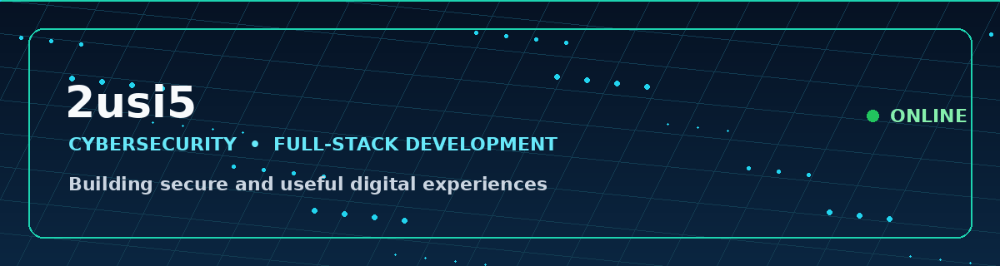

<p align="center">
  
</p>

<h1 align="center">Youssef Al-Shammari | 2usi5</h1>

<p align="center">
  <strong>Cybersecurity Student · Full-Stack Developer · Hardware Specialist</strong>
</p>

<p align="center">
  <a href="https://github.com/2usi5"></a>
  <a href="https://www.google.com/maps/search/Basra%2C%20Iraq"></a>
</p>

## About Me

I am **Youssef Al-Shammari**, a cybersecurity student and full-stack developer based in Basra, Iraq. I build practical cybersecurity tools, Android applications, and accessible web experiences.

## Skills

| Area | Technologies and experience |
| --- | --- |
| Cybersecurity | Kali Linux, penetration testing, Nmap, Metasploit, service and network analysis |
| Programming | Python, Kotlin, Java, JavaScript, HTML, CSS |
| Android | Android UI development, link and email checks, security notifications |
| Web development | RTL-ready pages, front-end stores, local storage, responsive design |
| Hardware | Smartphone and computer repair and diagnostics |

## Projects

### Youssef Al-Shammari Store

A browser-based computer store that starts in English and supports Arabic. It includes product browsing, a shopping cart, order form, local admin panel, language and currency switching, live search, theme switching, and responsive design.

> Main file: `Youssef Al-Shammari Store`

### Security Guard App

An Android prototype written in Kotlin that checks basic security indicators such as common phishing terms, password strength, suspicious link keywords, installed applications, and Wi-Fi status.

> File: `Security-Guard-App`

### STORE2

An older, simplified store prototype kept for comparison and reference.

## Run Locally

The store does not require a backend or external packages:

```bash
git clone https://github.com/2usi5/2usi5.git
cd 2usi5
python3 -m http.server 8000
```

Then open:

```text
http://localhost:8000/Youssef%20Al-Shammari%20Store
```

## Security Notes

- The store is a **front-end demo**; orders are saved in the user's browser and are not sent to a server.
- The admin login is client-side only and is not real security. Add a secure backend and authentication before handling real customer data.
- Never store passwords, API keys, or payment information in this repository.

## Certification

I completed a cybersecurity fundamentals certification from Hackviser, with practical training in network and service scanning, databases, and ethical hacking concepts.

## Team Cyber

I lead a technical team in Basra focused on cybersecurity, tool development, networking, technical support, and hardware maintenance.

- i9gkc — Security research partner and tool development.
- Khalil — Network specialist.
- Ahmed Hazem — Cybersecurity.
- Ali Fadel — Technical support.
- Hussein Alaa — Hardware programming.
- Alaa Jabbar — Media and maintenance.

## Contact

- GitHub: [@2usi5](https://github.com/2usi5)
- Instagram: [@2usi5](https://instagram.com/2usi5)
- Location: Basra, Iraq
